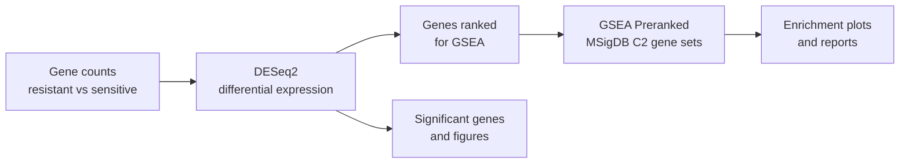
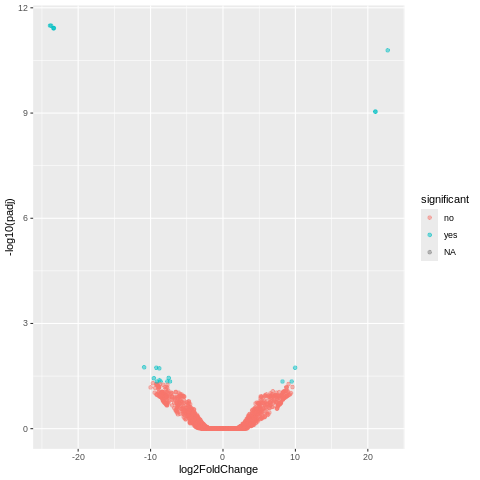

# Transcriptomic Analysis of Cisplatin-Resistant vs. Sensitive Oral Squamous Cell Carcinoma (OSCC)

Differential expression (DESeq2) and gene set enrichment analysis (GSEA) of RNA-seq data from cisplatin-resistant and cisplatin-sensitive OSCC, to look for pathway-level differences between the two groups, including metabolic ones.

**Tools:** DESeq2 (R/Bioconductor, run in Google Colab) · GSEA Preranked · MSigDB C2 gene sets

---

## Dataset

| | |
|---|---|
| Source | NCBI GEO, accession [FILL IN: GSE number] |
| Disease model | Oral squamous cell carcinoma (OSCC) |
| Comparison | Cisplatin-resistant vs. cisplatin-sensitive |
| Samples | [FILL IN: number of resistant and sensitive samples] |
| Input to DESeq2 | [FILL IN: gene count matrix downloaded from GEO, or counts generated by alignment (HISAT2) and featureCounts] |

## Workflow



| Step | Tool | What was done |
|---|---|---|
| 1. Differential expression | DESeq2 in Google Colab | Resistant vs. sensitive comparison across 34,552 genes (Ensembl IDs) |
| 2. Significant genes | DESeq2 output | 21 genes in the significant results file (thresholds: [FILL IN: for example log2 fold change above 1 and adjusted p-value below 0.05]) |
| 3. Ranking | DESeq2 output | Ranked gene list by [FILL IN: ranking metric, for example the Wald statistic or log2 fold change], gene symbols collapsed |
| 4. Enrichment | GSEA Preranked | MSigDB **C2 curated collection** (v2024.1, human), 1,000 permutations, gene set size 5 to 1,000, weighted scoring |

GSEA was run on the full C2 collection (KEGG, Reactome, WikiPathways, PID and other curated sets). It was **not** restricted to metabolic gene sets.

## Results

### DESeq2

| File | Contents |
|---|---|
| [`results/deseq2/DESeq2_results_all.csv`](results/deseq2/DESeq2_results_all.csv) | All tested genes: base mean, log2 fold change, standard error, test statistic, p-value, adjusted p-value |
| [`results/deseq2/DESeq2_significant_results.csv`](results/deseq2/DESeq2_significant_results.csv) | The 21 genes passing the significance thresholds |



*[FILL IN: one sentence saying what this plot shows, for example a volcano plot of log2 fold change against adjusted p-value.]*

### GSEA

Full output is in [`results/gsea/my_analysis.GseaPreranked/`](results/gsea/my_analysis.GseaPreranked/):

- `gsea_report_for_na_pos_*.tsv` and `gsea_report_for_na_neg_*.tsv`: enriched gene sets for each side of the ranking
- `enplot_*.png`: enrichment plots for individual gene sets
- `for ppt/`: HTML versions of the GSEA reports
- `edb/`: the ranked list (`.rnk`), gene sets used (`.gmt`) and GSEA database

A pathway visualization is in [`results/figures/pathway_view.pdf`](results/figures/pathway_view.pdf).

**Main finding:** [FILL IN: one or two sentences in your own words, for example which gene sets were most enriched in resistant cells.]

## Repository structure

```text
.
├── README.md
└── results/
    ├── deseq2/       # DESeq2 result tables
    ├── figures/      # summary figures
    └── gsea/         # GSEA Preranked output
```

## Limitations

- The groups are small if the study has few replicates. Treat enrichment results as hypotheses to follow up, not as final conclusions.
- The analysis used published data from GEO. No metabolomics data were integrated.

## Author

**Kirti Vishwakarma**, M.Sc. Bioinformatics
[LinkedIn](https://www.linkedin.com/in/kirti-vishwakarma-b69bb9229/) · [GitHub](https://github.com/livolo)